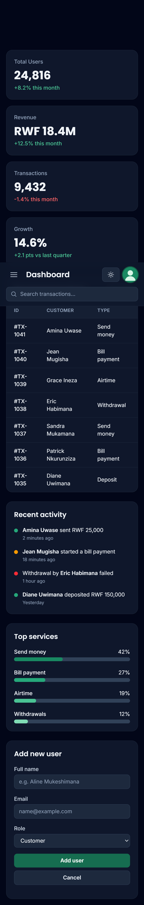
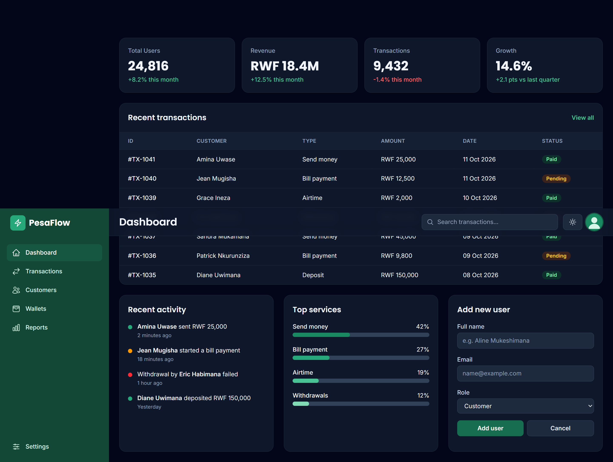

**Live site:** https://seberaisimbiangethressy-creator.github.io/week3-tailwind-dashboard/

# PesaFlow Admin Dashboard

A responsive admin dashboard for a fictional mobile-money app, built with plain HTML and Tailwind CSS v4 (installed through Vite, not the Play CDN). It has a sidebar, top bar, stat cards, a scrollable data table with status badges, activity and progress panels, an "Add new user" form, dark mode and a mobile menu toggle.

## Run locally

```bash
npm install
npm run dev      # development server
npm run build    # production build in dist/
```

## Screenshots

| Mobile (375px) | Desktop (1440px) |
| --- | --- |
|  |  |

## How I customized Tailwind

I extended the theme in `src/style.css` using `@theme`. I added a `brand` colour palette (shades 50 to 950, a green inspired by money and growth) and two custom fonts: Poppins for headings (`font-display`) and Inter for body text (`font-sans`). This gives me utilities like `bg-brand-700` and `font-display` across the whole project.

I also created reusable component classes inside `@layer components` with `@apply`: `.card` (white rounded panel with shadow), `.btn-primary` and `.btn-secondary` (buttons with hover, focus ring and transition), `.badge-paid`, `.badge-pending` and `.badge-failed` (coloured status pills), `.nav-link` (sidebar links), and `.field` / `.field-label` (form inputs and labels). This keeps the HTML short because the long utility lists live in one place. Dark mode uses a custom `dark` variant toggled by a class on the `<html>` element and saved in localStorage.

# Responsive behaviour

- Sidebar: hidden on mobile (opens with the menu button), always visible from `lg:`.
- Stat cards: 1 column, 2 at `md:`, 4 at `xl:`.
- Table: wrapped in `overflow-x-auto` so it scrolls sideways on small screens.
- Tested at 375px, 768px, 1024px and 1440px.
